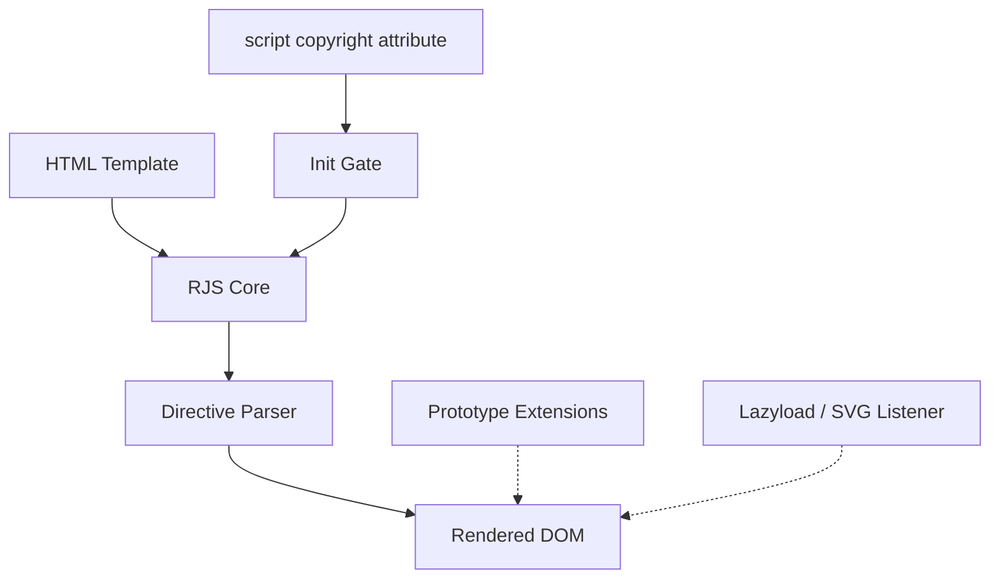

> [!NOTE]
> This README was generated by [SKILL](https://github.com/agenvoy/skill-readme-generate), get the ZH version from [here](./doc/README.zh.md).

> [!WARNING]
> **Archived on 2026-10-30.** RenderJS is no longer maintained. The final release is `v2.0.3`; `npm i @pardnchiu/renderjs` and the jsDelivr build remain available, but no new features, bug fixes, or security updates will be published, and issues and pull requests are no longer accepted.

***

<strong>EXTEND NATIVE JS PROTOTYPES, RENDER WITHOUT THE OVERHEAD</strong>

***

> A JavaScript library with chainable DOM construction, a one-shot template engine, and native prototype extensions

## Table of Contents

- [Features](#features)
- [Architecture](#architecture)
- [License](#license)
- [Author](#author)

## Features

> `npm i @pardnchiu/renderjs` · [Documentation](./doc/doc.md)

- **Chainable DOM Construction** — Build real DOM elements straight from tag-selector strings instead of verbose createElement chains.
- **One-Shot Template Engine** — Declarative directives render into the DOM in a single pass, with no virtual-DOM diffing or reactive watching, so you decide exactly when the view updates.
- **Native Prototype Extensions** — Dozens of chainable methods on String, Array, Object, Element, URL, and window cover element queries, requests, query strings, and cookies.
- **Built-in Lazyload and SVG Inlining** — One call enables IntersectionObserver-driven image lazy loading and automatic inlining of external SVG files.
- **Zero-Dependency Single File** — One minified file runs directly in the browser, installed via npm or a CDN script tag.

## Architecture

> [Full Architecture](./doc/architecture.md)

## License

This project is licensed under the [MIT LICENSE](LICENSE).

## Author

Just [open an issue](https://github.com/pardnchiu/renderjs/issues/new) to share an idea.

***

©️ 2022 [邱敬幃 Pardn Chiu](https://www.linkedin.com/in/pardnchiu)
