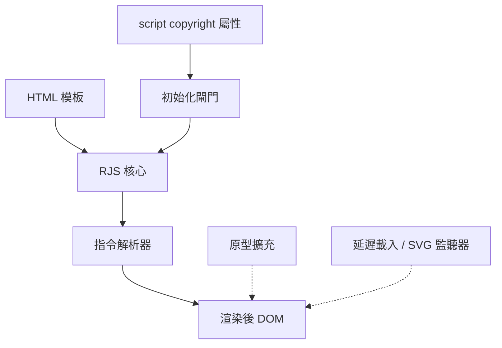

> [!NOTE]
> 此 README 由 [SKILL](https://github.com/agenvoy/skill-readme-generate) 生成，英文版請參閱 [這裡](../README.md)。

***

<strong>EXTEND NATIVE JS PROTOTYPES, RENDER WITHOUT THE OVERHEAD</strong>

***

> JavaScript 函式庫，具備鏈式 DOM 建構、一次性模板引擎與原生原型擴充

## 目錄

- [功能特點](#功能特點)
- [架構](#架構)
- [授權](#授權)
- [Author](#author)

## 功能特點

> `npm i @pardnchiu/renderjs` · [完整文件](./doc.zh.md)

- **鏈式 DOM 建構** — 以標籤選擇器字串直接產生真實 DOM 元素，取代冗長的 createElement 呼叫鏈。
- **一次性模板引擎** — 宣告式指令單次渲染進 DOM，不做虛擬 DOM 比對也不做自動響應式監聽，更新時機完全由開發者掌控。
- **原生原型擴充** — 為 String、Array、Object、Element、URL 與 window 補上數十個可串接的方法，涵蓋元素查詢、請求、查詢字串與 Cookie。
- **內建延遲載入與 SVG 內嵌** — 一行啟用以 IntersectionObserver 驅動的圖片延遲載入與外部 SVG 自動內嵌。
- **零相依單檔部署** — 單一壓縮檔即可透過 npm 或 CDN script 標籤直接在瀏覽器執行。

## 架構

> [完整架構](./architecture.zh.md)

## 授權

本專案採用 [MIT LICENSE](../LICENSE)。

## Author

Just [open an issue](https://github.com/pardnchiu/renderjs/issues/new) to share an idea.

***

©️ 2022 [邱敬幃 Pardn Chiu](https://www.linkedin.com/in/pardnchiu)
