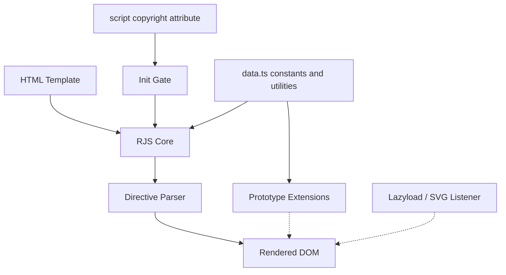
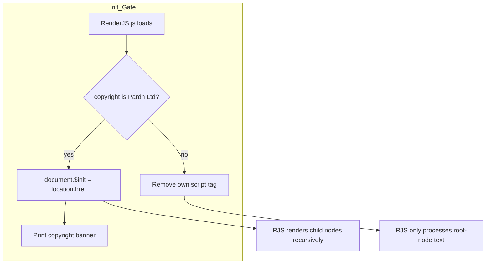
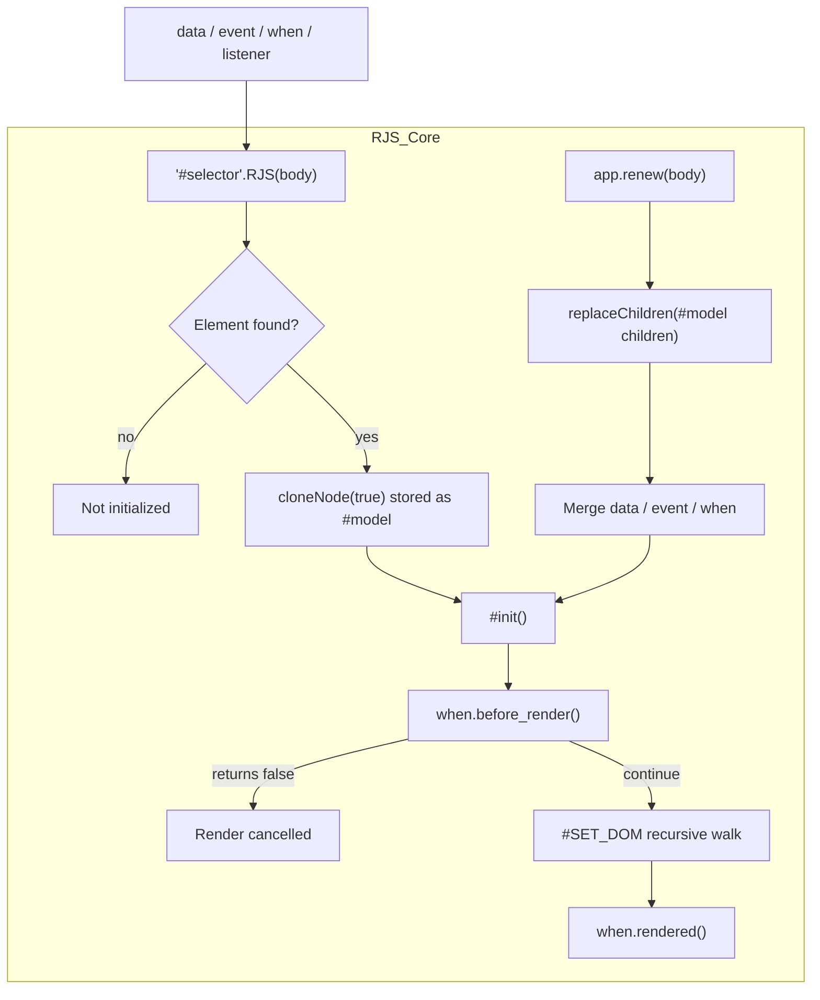
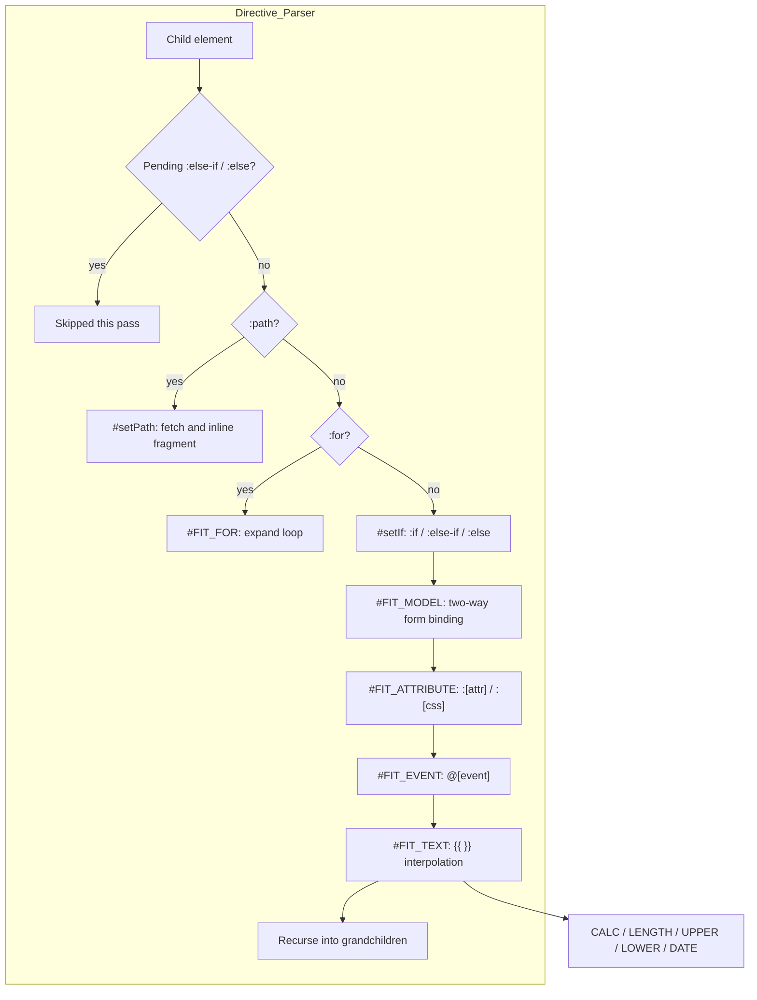
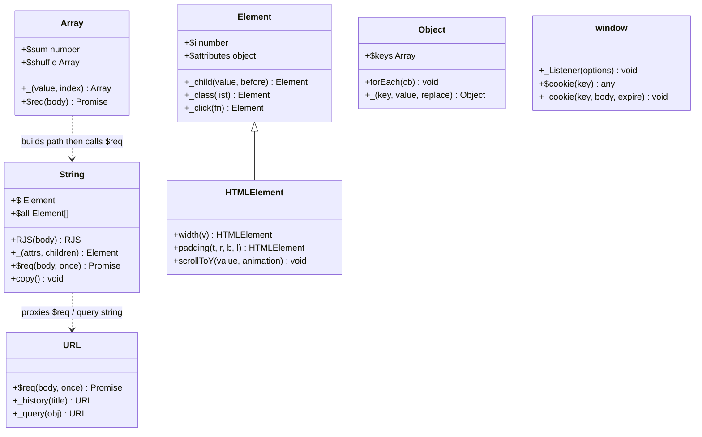
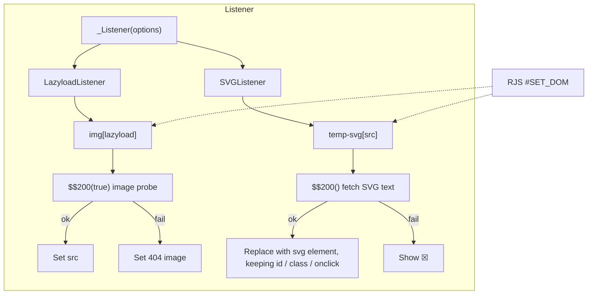
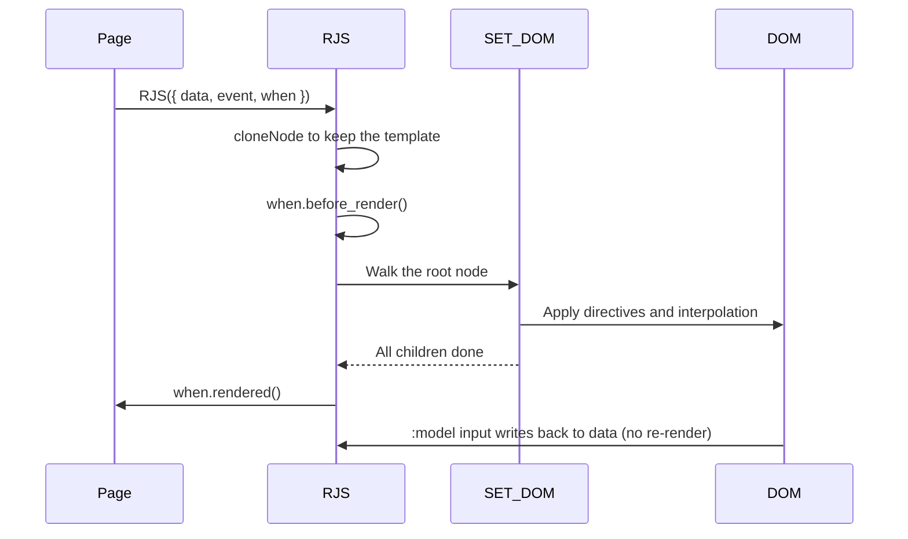

# renderjs - Architecture

> Back to [README](../README.md)

## Overview

## Module: Init Gate

On load, the current script tag's `copyright` attribute decides whether `RJS` can recursively render child nodes.

## Module: RJS Core

The `RJS` class (`src/model/RJS.ts`) keeps a clone of the original template plus `data`/`event`/`when`, and drives the single render pass.

## Module: Directive Parser

`#SET_DOM` applies directives to each child element in a fixed order; `:path` and `:for` hand off to their own handlers and return early.

## Module: Prototype Extensions

Each `src/prototype/*.ts` file extends the matching native prototype on load, with type declarations in `src/interface/*.ts`; the URL-related `String` methods delegate to the `URL` implementation.

## Module: Listener

`_Listener()` creates two global `IntersectionObserver` instances; `RJS` also hands matching nodes to them while rendering.

## Data Flow

***

©️ 2022 [邱敬幃 Pardn Chiu](https://www.linkedin.com/in/pardnchiu)
