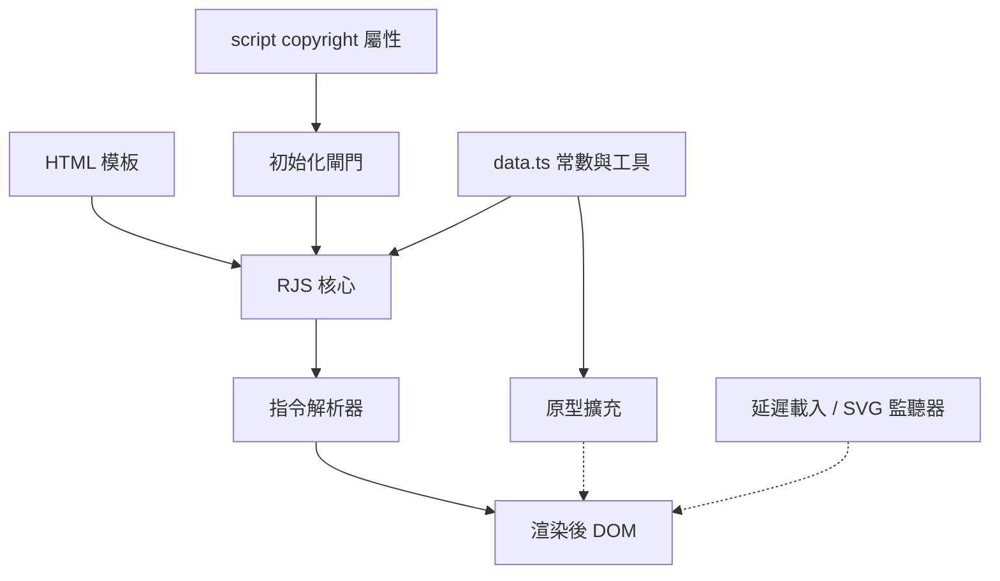
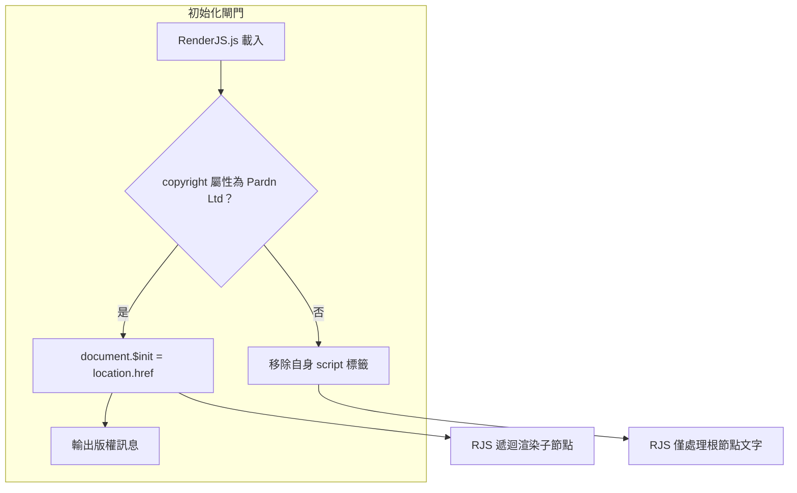
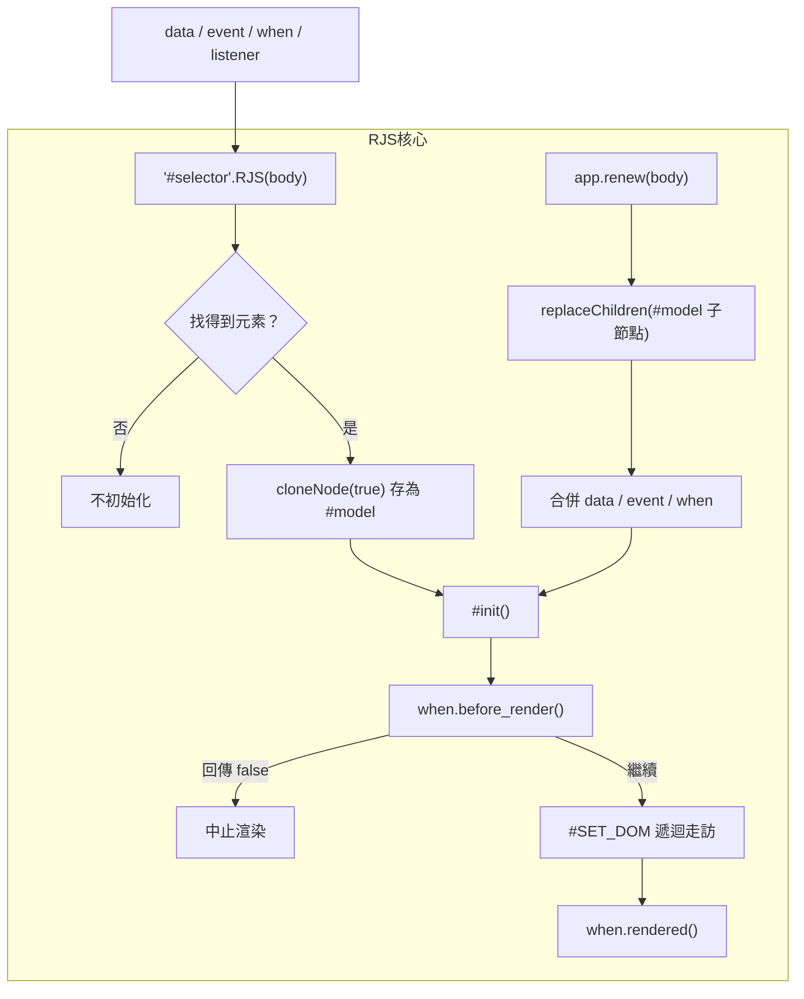
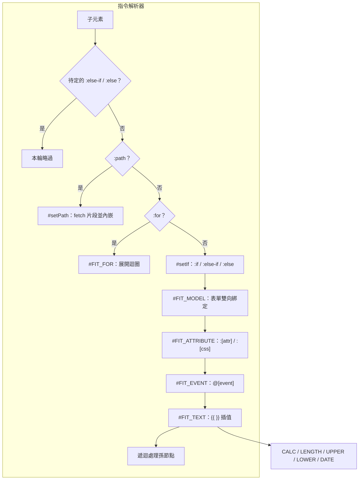
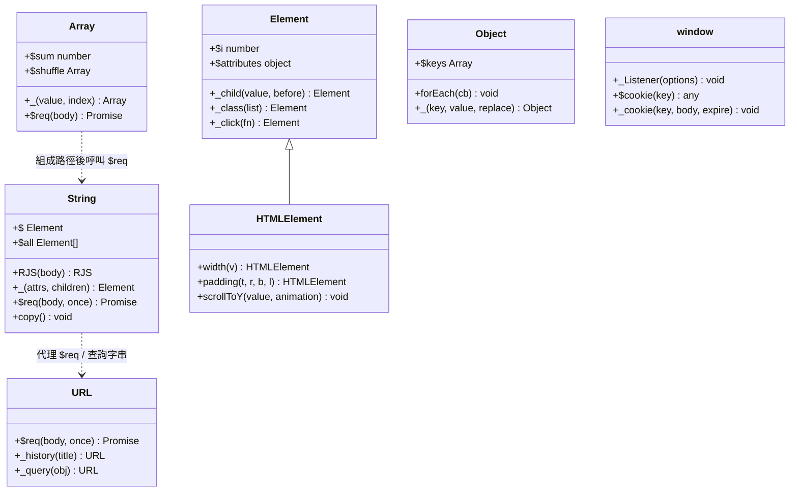
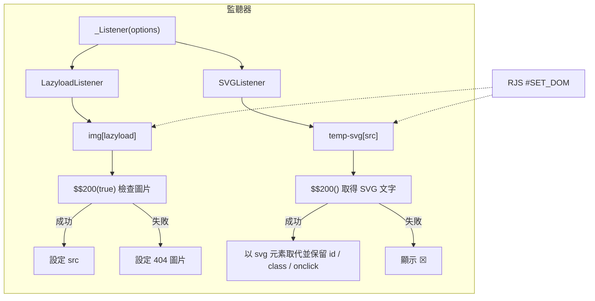
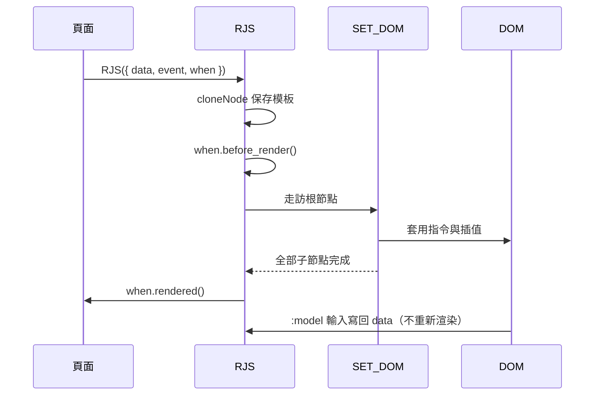

# renderjs - 架構

> 返回 [README](./README.zh.md)

## 概覽

## Module: 初始化閘門

載入時檢查目前 script 標籤的 `copyright` 屬性，決定 `RJS` 是否能遞迴渲染子節點。

## Module: RJS 核心

`RJS` 類別（`src/model/RJS.ts`）保存原始模板的複本、`data`／`event`／`when`，並驅動單次渲染。

## Module: 指令解析器

`#SET_DOM` 依固定順序對每個子元素套用指令；`:path` 與 `:for` 交由專屬處理器後直接返回。

## Module: 原型擴充

`src/prototype/*.ts` 載入時直接擴充對應的原生原型，`src/interface/*.ts` 提供型別宣告；`String` 的 URL 相關方法轉交 `URL` 實作。

## Module: 監聽器

`_Listener()` 建立兩個全域 `IntersectionObserver`；`RJS` 渲染時也會把符合條件的節點交給它們觀察。

## 資料流

***

©️ 2022 [邱敬幃 Pardn Chiu](https://www.linkedin.com/in/pardnchiu)
