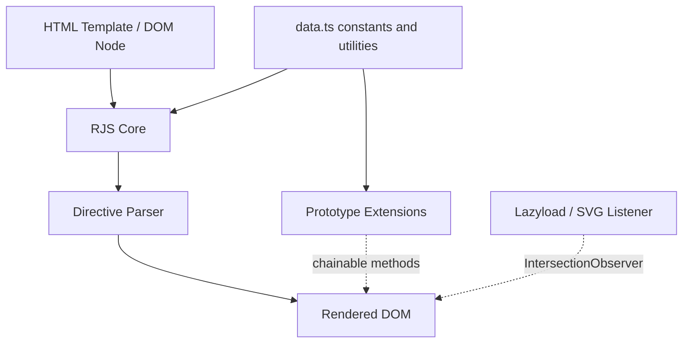

# Architecture

Module-level layout of RenderJS: a single `data.ts` constants module underpins both the `RJS` template engine and the native prototype extensions, with a separate `IntersectionObserver`-based listener layer for lazyload/SVG.

## Overview

## Layers

| Layer | Location | Responsibility |
| --- | --- | --- |
| Constants & utilities | `src/data.ts` | Minified property-name aliases (`$GET`, `$ADD`, `$IS`, ...), shared regexes (`REGEX_TEXT`, `REGEX_FOR_VAL0`, ...), and globals like `requestMap`/`userHistory` used across every other module |
| RJS core | `src/model/RJS.ts` | The `RJS` class: instance lifecycle (`constructor`, `renew`, `#init`) and the directive-parsing pipeline (`#SET_DOM` and its `#FIT_*`/`#setIf`/`#setPath` helpers) |
| Prototype extensions | `src/prototype/*.ts` (+ `src/interface/*.ts` for typings) | Each file extends one native constructor's `.prototype` directly on module load — `String`, `Element`, `Array`, `Object`, `URL`, `window`, `Date`, `Number`, `Map`, `Image`, `HTMLElement`, `File`, `HTMLVideoElement`, `HTMLFormElement`, `HTMLLinkElement`, `FormData`, `DocumentFragment` |
| Listener subsystem | `src/listener/*.ts`, `src/function/listener.ts` | Global `IntersectionObserver` instances for image lazyload and SVG inlining, entered through `window._Listener(...)` |
| Support functions | `src/function/*.ts` | `getCamelString` (kebab-to-camel for CSS property lookups), `printLog`/`printCopyright` (console banner) |
| Bundle entry | `src/RenderJS.js` | Compiled/concatenated output of the above, minified into `dist/RenderJS.js` via `terser` (`npm run minify`) |

## Cross-Cutting Notes

- **Load-order coupling**: prototype files run `(_this => { ... })($Type[_prototype])` as an IIFE at import time — there is no explicit init call, so import order in `src/RenderJS.js` determines which extensions exist when `RJS.ts` first runs.
- **No virtual DOM**: the directive parser (`RJS.ts`) mutates real DOM nodes in place; re-render is only triggered by an explicit `renew()` call, never automatically.
- **Property-name obfuscation**: `data.ts` defines every DOM/JS property name used elsewhere as a `const _xxx = "xxx"` (and further composes them, e.g. `_appendChild = "append" + _Child`). This is a minification strategy, not a runtime abstraction — treat `_ary[_push](x)` as `ary.push(x)` when reading source.

For directive-pipeline detail see [Directive Parsing](/core-concepts-directives); for the full prototype method list see [API Reference](/api-reference); for module-level sequence/state diagrams see the [full architecture document](https://github.com/pardnchiu/renderjs/blob/main/doc/architecture.md).
