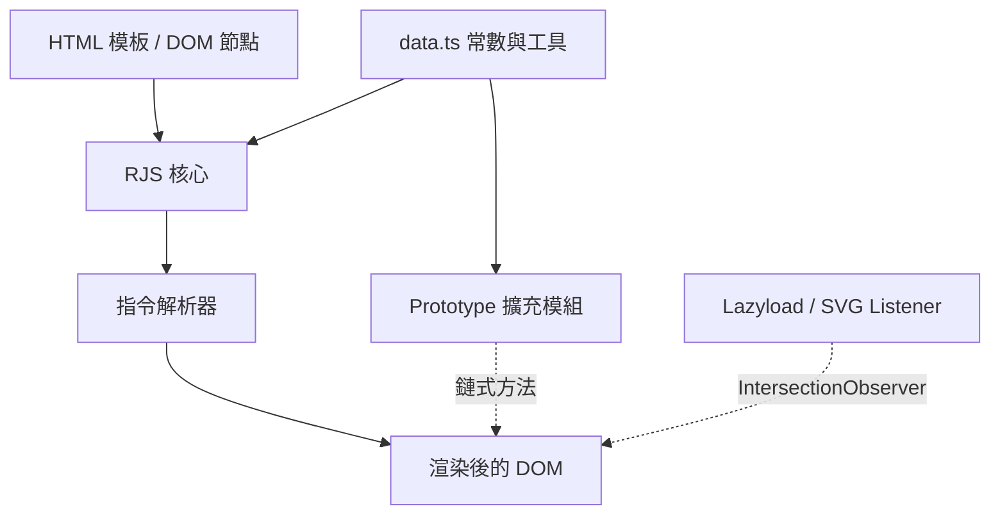

# 架構

RenderJS 的模組層級配置：單一 `data.ts` 常數模組同時支撐 `RJS` 模板引擎與原生 prototype 擴充，另有獨立的 `IntersectionObserver` listener 層負責 lazyload／SVG。

## 概覽

## 分層

| 層級 | 位置 | 職責 |
| --- | --- | --- |
| 常數與工具 | `src/data.ts` | 縮寫屬性名稱別名（`$GET`、`$ADD`、`$IS` ...）、共用正則（`REGEX_TEXT`、`REGEX_FOR_VAL0` ...），以及跨模組共用的全域變數如 `requestMap`／`userHistory` |
| RJS 核心 | `src/model/RJS.ts` | `RJS` 類別：實例生命週期（`constructor`、`renew`、`#init`）與指令解析流程（`#SET_DOM` 及其 `#FIT_*`／`#setIf`／`#setPath` 輔助函式）|
| Prototype 擴充 | `src/prototype/*.ts`（型別定義於 `src/interface/*.ts`）| 每個檔案在模組載入時直接擴充對應原生建構子的 `.prototype`——涵蓋 `String`、`Element`、`Array`、`Object`、`URL`、`window`、`Date`、`Number`、`Map`、`Image`、`HTMLElement`、`File`、`HTMLVideoElement`、`HTMLFormElement`、`HTMLLinkElement`、`FormData`、`DocumentFragment` |
| Listener 子系統 | `src/listener/*.ts`、`src/function/listener.ts` | 全域 `IntersectionObserver` 實例，負責圖片延遲載入與 SVG 內嵌，透過 `window._Listener(...)` 進入 |
| 輔助函式 | `src/function/*.ts` | `getCamelString`（kebab 轉 camel，供 CSS 屬性查找）、`printLog`／`printCopyright`（console 橫幅）|
| 打包進入點 | `src/RenderJS.js` | 上述模組編譯／串接後的產物，透過 `terser` 壓縮為 `dist/RenderJS.js`（`npm run minify`）|

## 跨切面說明

- **載入順序耦合**：prototype 檔案以 `(_this => { ... })($Type[_prototype])` IIFE 形式在載入時執行——沒有明確的 init 呼叫，因此 `src/RenderJS.js` 的 import 順序決定了 `RJS.ts` 首次執行時哪些擴充已存在。
- **無虛擬 DOM**：指令解析器（`RJS.ts`）直接原地修改真實 DOM 節點；重新渲染僅由明確呼叫 `renew()` 觸發，絕不自動發生。
- **屬性名稱混淆**：`data.ts` 將其他模組使用的每個 DOM／JS 屬性名稱定義為 `const _xxx = "xxx"`（並進一步組合，如 `_appendChild = "append" + _Child`）。這是一種壓縮策略，而非執行期抽象層——閱讀原始碼時可將 `_ary[_push](x)` 理解為 `ary.push(x)`。

指令解析流程細節見 [指令解析](/zh/core-concepts-directives)；完整 prototype 方法列表見 [API 參考](/zh/api-reference)；模組層級的 sequence／state diagram 見 [完整架構文件](https://github.com/pardnchiu/renderjs/blob/main/doc/architecture.md)。
