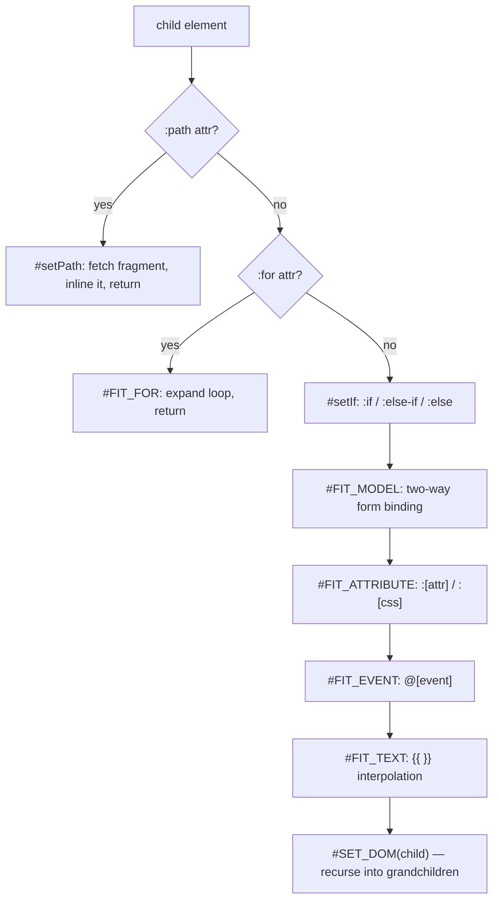

# Directive Parsing

The order in which `RJS`'s `#SET_DOM` applies directives while walking a template, and what each directive (`:path`, `:for`, `:if`, `:model`, `:[attr]`, `@[event]`) does.

## Directive Parsing Order

`#SET_DOM` walks each child element and applies directives in a fixed order. `:path`- and `:for`-tagged nodes short-circuit into their own handlers and skip the rest of the pipeline for that node:



Elements whose visibility is still pending (`:else-if`/`:el-if`/`:else` siblings not yet resolved by `#setIf`) are skipped on this pass; `#setIf` re-invokes `#SET_DOM` on the parent once it has removed the losing branches.


## Directive Behavior

### `:path` — async fragment loading

Applies only to elements carrying a `:path` attribute. `#setPath` `fetch`es the target URL, injects the returned HTML as child nodes, and re-runs `#SET_DOM` on the fragment (unless the fragment contains a `new PD` construction, in which case it's left untouched). Script tags found in the fragment are moved to the end of `document.body` and executed; everything else is unwrapped in place, and the original placeholder node is removed. A fetch failure also removes the node.

### `:for` — loop expansion

Supports three forms: `item in items`, `(item, index) in items`, and `(key, value) in object`. `#FIT_FOR` clones the template node once per array entry (or object key), binds `subItem = { [val0]: item, [val1]: index }` (or `{ [val0]: key, [val1]: value }`), and renders each clone's attributes/events/text into a `DocumentFragment`. Nested-object items get a full recursive `#SET_DOM` pass; primitive items only get attribute/event/text substitution.

The fragment is then inserted with `Element._child`, which converts any value that is not an `Element` into a text node, so the loop's output in the page is the literal text `[object DocumentFragment]` at the original node's position:

```demo
<ul id="app">
    <li :for="(item, index) in items">{{ index }}: {{ item }}</li>
</ul>
<script>
    "#app".RJS({ data: { items: ["dom", "template"] } });
    console.log("app".$.innerHTML.trim());
</script>
```

### `:if` / `:else-if` / `:el-if` / `:else`

`#setIf` collects the `:if` node and any immediately-following `:else-if`/`:el-if`/`:else` siblings into one group, evaluates each condition in order, and removes every node except the first one that matches (later matches in the group are removed even if their own condition is true). Supported operators: `>`, `<`, `>=`/`>==`, `<=`/`<==`, `==`/`===`, `!=`/`!==`. `==`/`!=` special-case the literals `null`, `true`, `false`, and `empty` (empty-string check) before falling back to string equality.

After the group is resolved, `#SET_DOM` keeps walking the removed nodes; reading their `$i` index throws a `TypeError` with the message "Cannot read properties of null (reading 'children')". The DOM is already in its final state when the error is thrown.

```demo
<div id="app">
    <p :if="score >= 90">Grade: A</p>
    <p :else-if="score >= 60">Grade: pass</p>
    <p :else>Grade: fail</p>
    <p :if="note == empty">No note</p>
    <p :if="active == true">Active</p>
</div>
<script>
    "#app".RJS({
        data: { score: 75, note: "", active: true }
    });
</script>
```

### `:model` — two-way form binding

`#FIT_MODEL` inspects the bound element's type: checkbox/radio inputs listen on `change` and join all checked values with `,`; `select` listens on `change`; plain `input`/`textarea` listen on both `keyup` and `change`. In every case the handler writes straight into the `data` object passed to that render pass — there is no observer or reactive re-render triggered by the write.

```demo
<div id="app">
    <input :model="name" placeholder="Type a name">
    <select :model="plan">
        <option value="free">Free</option>
        <option value="pro">Pro</option>
    </select>
    <button @click="show">Show data</button>
    <pre id="out"></pre>
</div>
<script>
    const app = "#app".RJS({
        data: { name: "", plan: "free" },
        event: {
            show: function () {
                "out".$.textContent = JSON.stringify(app.data);
            }
        }
    });
</script>
```

### `:[attr]` / `:[css]` — attribute and style binding

`#FIT_ATTRIBUTE` collects every attribute matching `/^:[\w\-]+$/` (excluding the directive names above), resolves its value through `#GET_VALUE`, and hands it to `#SET_ATTRIBUTE`. `:class` calls `_class()` (see [Element Extensions](/api-reference-element)); `:id`/`:src`/`:alt`/`:href`/`:html` map directly onto the matching DOM property; any other camel-cased key that exists on `element.style` is treated as a CSS property; and every binding, including the cases above, is also written as a plain HTML attribute of the same name without the colon (or that attribute is removed when the resolved value is empty).

```demo
<div id="app">
    <a :href="link.url" :class="link.cls" :color="link.color">{{ link.text }}</a>
    <br>
    
</div>
<script>
    "#app".RJS({
        data: {
            link: { url: "https://github.com/pardnchiu/renderjs", cls: "primary", color: "steelblue", text: "RenderJS" },
            logo: "/assets/cover.png"
        }
    });
</script>
```

### `@[event]` — event binding

`#FIT_EVENT` matches attributes like `/^@[\w]+$/`, rewrites `@click` to `onclick`, and looks up the handler name in `this.event`. Inside a `:for` loop, the handler name can itself be a per-item value (resolved through the same key-path lookup used for `{{ }}` interpolation) rather than a fixed method name.

```demo
<div id="app">
    <button @click="greet">Click me</button>
    <p id="msg"></p>
</div>
<script>
    "#app".RJS({
        event: {
            greet: function () {
                "msg".$.textContent = "Clicked";
            }
        }
    });
</script>
```
