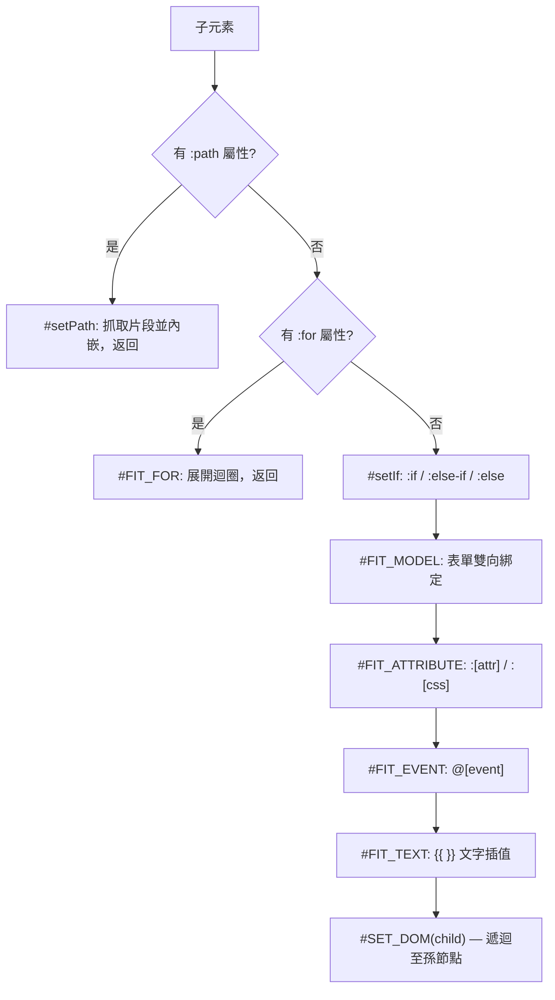

# 指令解析

`RJS` 的 `#SET_DOM` 走訪模板時套用指令的順序，以及每個指令（`:path`、`:for`、`:if`、`:model`、`:[attr]`、`@[event]`）的行為。

## 指令解析順序

`#SET_DOM` 依序走訪每個子元素並套用指令。帶有 `:path` 或 `:for` 標籤的節點會短路進入各自的處理函式，並跳過該節點後續的流程：



尚未由 `#setIf` 判定完成（後方仍有待解析的 `:else-if`／`:el-if`／`:else` 兄弟節點）的元素會在這一輪被跳過；`#setIf` 移除落敗分支後，會對父節點重新呼叫一次 `#SET_DOM`。


## 各指令行為

### `:path` — 非同步片段載入

僅套用於帶 `:path` 屬性的元素。`#setPath` 會 `fetch` 目標 URL，將回傳的 HTML 作為子節點插入，並對該片段重新執行 `#SET_DOM`（除非片段內含 `new PD` 建構式，此時不處理）。片段中的 `script` 標籤會被移至 `document.body` 底部執行；其餘內容原地展開，原本的佔位節點會被移除。fetch 失敗時同樣會移除該節點。

### `:for` — 迴圈展開

支援三種格式：`item in items`、`(item, index) in items`、`(key, value) in object`。`#FIT_FOR` 針對每個陣列項目（或物件鍵）複製一份模板節點，綁定 `subItem = { [val0]: item, [val1]: index }`（或 `{ [val0]: key, [val1]: value }`），對每份複本渲染屬性／事件／文字後放入一個 `DocumentFragment`。巢狀物件項目會進行完整的遞迴 `#SET_DOM`；純值項目則只做屬性／事件／文字代換。

接著以 `Element._child` 插入該片段，而 `_child` 會把非 `Element` 的值轉成文字節點，因此迴圈在頁面上的輸出是位於原節點位置的字面文字 `[object DocumentFragment]`：

```demo
<ul id="app">
    <li :for="(item, index) in items">{{ index }}: {{ item }}</li>
</ul>
<script>
    "#app".RJS({ data: { items: ["dom", "template"] } });
    console.log("app".$.innerHTML.trim());
</script>
```

### `:if` / `:else-if` / `:el-if` / `:else`

`#setIf` 會將 `:if` 節點與其後緊接的 `:else-if`／`:el-if`／`:else` 兄弟節點收集為一組，依序評估各條件，僅保留第一個符合的節點（同組內即使後方節點自身條件成立，也一律移除）。支援的運算子：`>`、`<`、`>=`／`>==`、`<=`／`<==`、`==`／`===`、`!=`／`!==`。`==`／`!=` 會先特判 `null`、`true`、`false`、`empty`（空字串檢查）等字面值，其餘才回退為字串相等比較。

整組判斷完成後，`#SET_DOM` 仍會走訪已被移除的節點，讀取其 `$i` 索引時拋出 `TypeError`，訊息為「Cannot read properties of null (reading 'children')」；拋錯時 DOM 已是最終結果。

```demo
<div id="app">
    <p :if="score >= 90">Grade: A</p>
    <p :else-if="score >= 60">Grade: pass</p>
    <p :else>Grade: fail</p>
    <p :if="note == empty">No note</p>
    <p :if="active == true">Active</p>
</div>
<script>
    "#app".RJS({
        data: { score: 75, note: "", active: true }
    });
</script>
```

### `:model` — 表單雙向綁定

`#FIT_MODEL` 依綁定元素型別分派：checkbox／radio 監聽 `change`，並將所有勾選值以 `,` 串接；`select` 監聽 `change`；純 `input`／`textarea` 同時監聽 `keyup` 與 `change`。無論哪種情況，handler 都是直接寫入該次渲染傳入的 `data` 物件——寫入本身不會觸發任何 observer 或響應式重新渲染。

```demo
<div id="app">
    <input :model="name" placeholder="Type a name">
    <select :model="plan">
        <option value="free">Free</option>
        <option value="pro">Pro</option>
    </select>
    <button @click="show">Show data</button>
    <pre id="out"></pre>
</div>
<script>
    const app = "#app".RJS({
        data: { name: "", plan: "free" },
        event: {
            show: function () {
                "out".$.textContent = JSON.stringify(app.data);
            }
        }
    });
</script>
```

### `:[attr]` / `:[css]` — 屬性與樣式綁定

`#FIT_ATTRIBUTE` 收集所有符合 `/^:[\w\-]+$/`（排除上述指令名稱）的屬性，透過 `#GET_VALUE` 解析其值後交給 `#SET_ATTRIBUTE`。`:class` 會呼叫 `_class()`（見 [Element 擴充](/zh/api-reference-element)）；`:id`／`:src`／`:alt`／`:href`／`:html` 直接對應到相同名稱的 DOM 屬性；其餘 camel-case 後存在於 `element.style` 上的鍵視為 CSS 屬性；此外，每個綁定（含上述情況）都會以去掉冒號的同名純 HTML attribute 寫入（解析值為空時改為移除該 attribute）。

```demo
<div id="app">
    <a :href="link.url" :class="link.cls" :color="link.color">{{ link.text }}</a>
    <br>
    
</div>
<script>
    "#app".RJS({
        data: {
            link: { url: "https://github.com/pardnchiu/renderjs", cls: "primary", color: "steelblue", text: "RenderJS" },
            logo: "/assets/cover.png"
        }
    });
</script>
```

### `@[event]` — 事件綁定

`#FIT_EVENT` 比對 `/^@[\w]+$/` 格式的屬性，將 `@click` 改寫為 `onclick`，並在 `this.event` 中查找對應的 handler 名稱。在 `:for` 迴圈內，handler 名稱本身也可以是逐項資料值（透過與 `{{ }}` 插值相同的 key-path 解析），而非固定方法名。

```demo
<div id="app">
    <button @click="greet">Click me</button>
    <p id="msg"></p>
</div>
<script>
    "#app".RJS({
        event: {
            greet: function () {
                "msg".$.textContent = "Clicked";
            }
        }
    });
</script>
```
