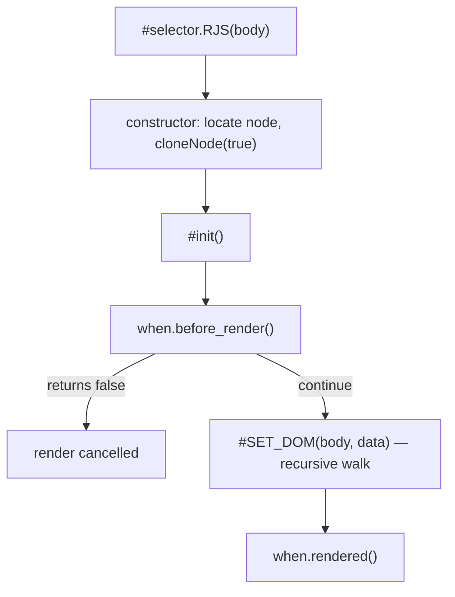

# Core Concepts

How an `RJS` instance (`src/model/RJS.ts`) is created and re-rendered, and why each render is a single, non-reactive pass.

## Instance Lifecycle

`"#selector".RJS(body)` looks up the target element via `body.id`, clones it as the pristine template (`#model`), and stores `data`/`event`/`when` on the instance. If the selector resolves to `null`, the constructor returns early and no instance is initialized.



`app.renew(body)` moves the children of the cloned `#model` back into the root element (`replaceChildren(...this.#model.children)`), merges the keys of `body.data` into `app.data` and the keys of `body.when` into the hooks (unmentioned keys keep their prior value), and re-runs `#init()`. `body.event` is not read; the keys of `body.data` are also copied into `app.event`, so `@[event]` bindings keep the handlers given at construction. Only the element children are moved, so whitespace text nodes from the template are not restored (see [First Child Node of the Root](/core-concepts-interpolation#first-child-node-of-the-root)). Because the template children are moved rather than cloned, `#model` is empty after the first `renew()`, and a second `renew()` leaves the root element empty. A non-object argument skips the merge and both hooks and only re-runs `#SET_DOM`. `renew()` is the only way an `RJS` instance re-renders — there is no automatic reactivity or dirty-checking.

The first `renew()` re-renders with the merged `data`; the second finds `#model` empty:

```demo
<div id="app">
    <h4>Counter</h4>
    <p>{{ count }}</p>
</div>
<script>
    const app = "#app".RJS({ data: { count: 1 } });
    console.log("render:", "app".$.$sel("p").textContent);
    app.renew({ data: { count: 2 } });
    console.log("renew 1:", "app".$.$sel("p").textContent);
    app.renew({ data: { count: 3 } });
    console.log("renew 2:", JSON.stringify("app".$.innerHTML));
</script>
```

`before_render` returning `false` cancels the pass, so `rendered` never runs and the template text stays as written:

```demo
<div id="app">
    <p>{{ msg }}</p>
</div>
<script>
    "#app".RJS({
        data: { msg: "rendered" },
        when: {
            before_render: () => {
                console.log("before_render");
                return false;
            },
            rendered: () => console.log("rendered")
        }
    });
    console.log("#app".$.textContent.trim());
</script>
```

## Non-Reactivity Is Deliberate

Every commented-out block in `RJS.ts` (`#dataListener`, the `Object.defineProperty` getter/setter pairs) is a removed reactive-observer mechanism. The shipped design renders once per `#init()` call and requires an explicit `renew()` to update — this trade-off is what the [README](/) describes as rendering "with no virtual-DOM diffing or reactive watching."

Alpine.js also reads directives such as `x-for` and `x-if` from markup, but it re-renders reactively when its data changes; an `RJS` instance renders its `:for`/`:if` directives once and changes only on `renew()`. Handlebars compiles a template string into a function that returns an HTML string, while `RJS` walks and rewrites DOM nodes that are already in the page.

## Related Topics

- [Directive Parsing](/core-concepts-directives): the order `#SET_DOM` applies directives in, and what each directive does
- [Text Interpolation](/core-concepts-interpolation): how `{{ }}` resolves values and helpers
