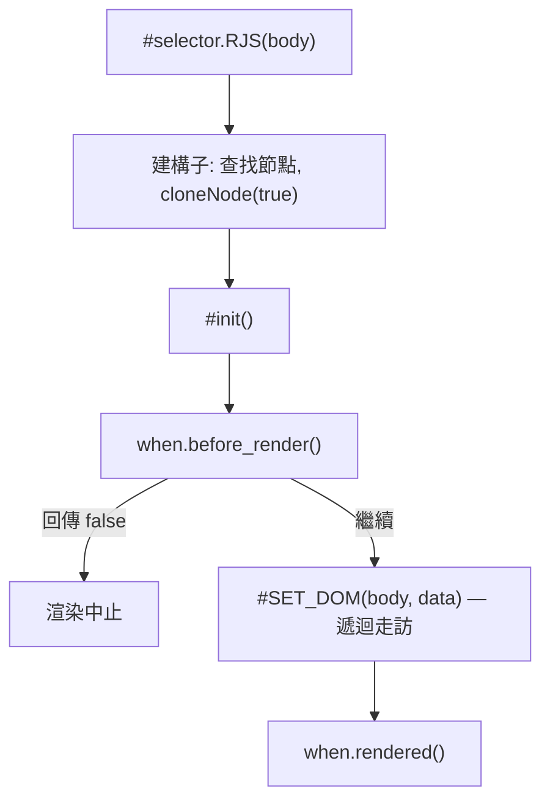

# 核心概念

`RJS` 實例（`src/model/RJS.ts`）如何建立與重新渲染，以及每次渲染為何是單次、非響應式。

## 實例生命週期

`"#selector".RJS(body)` 透過 `body.id` 查找目標元素，複製一份作為原始模板（`#model`），並將 `data`／`event`／`when` 儲存於實例上。若選擇器解析結果為 `null`，建構子會提早返回，不會初始化任何實例。



`app.renew(body)` 會把複製的 `#model` 子節點移回根元素（`replaceChildren(...this.#model.children)`），將 `body.data` 的鍵合併進 `app.data`、`body.when` 的鍵合併進鉤子（未提及的鍵維持原值），再重新執行 `#init()`。`body.event` 不會被讀取；`body.data` 的鍵也會被複製進 `app.event`，因此 `@[event]` 綁定的仍是建構時傳入的 handler。只有元素子節點會被移回，模板中的空白文字節點不會還原（見[根元素的第一個子節點](/zh/core-concepts-interpolation#根元素的第一個子節點)）。由於模板子節點是被移動而非複製，第一次 `renew()` 之後 `#model` 即為空，第二次 `renew()` 會讓根元素變成空的。傳入非物件時會跳過合併與兩個鉤子，只重新執行 `#SET_DOM`。`renew()` 是 `RJS` 實例重新渲染的唯一方式——沒有自動響應式或髒值檢查機制。

第一次 `renew()` 以合併後的 `data` 重新渲染；第二次時 `#model` 已為空：

```demo
<div id="app">
    <h4>Counter</h4>
    <p>{{ count }}</p>
</div>
<script>
    const app = "#app".RJS({ data: { count: 1 } });
    console.log("render:", "app".$.$sel("p").textContent);
    app.renew({ data: { count: 2 } });
    console.log("renew 1:", "app".$.$sel("p").textContent);
    app.renew({ data: { count: 3 } });
    console.log("renew 2:", JSON.stringify("app".$.innerHTML));
</script>
```

`before_render` 回傳 `false` 會中止這次渲染，`rendered` 不會執行，模板文字維持原樣：

```demo
<div id="app">
    <p>{{ msg }}</p>
</div>
<script>
    "#app".RJS({
        data: { msg: "rendered" },
        when: {
            before_render: () => {
                console.log("before_render");
                return false;
            },
            rendered: () => console.log("rendered")
        }
    });
    console.log("#app".$.textContent.trim());
</script>
```

## 非響應式是刻意設計

`RJS.ts` 中每一段被註解掉的程式碼（`#dataListener`、`Object.defineProperty` 的 getter/setter 對）都是被移除的響應式 observer 機制。現行設計每次 `#init()` 只渲染一次，需要明確呼叫 `renew()` 才會更新——這項取捨正是 [README](/zh/) 所述「不做虛擬 DOM 比對也不做自動響應式監聽」。

Alpine.js 同樣從標記讀取 `x-for`、`x-if` 等指令，但資料變動時會響應式重新渲染；`RJS` 實例只渲染一次 `:for`／`:if` 指令，之後只在 `renew()` 時改變。Handlebars 把模板字串編譯成回傳 HTML 字串的函式，`RJS` 則直接走訪並改寫頁面上既有的 DOM 節點。

## 延伸主題

- [指令解析](/zh/core-concepts-directives)：`#SET_DOM` 的指令處理順序與各指令行為
- [文字插值](/zh/core-concepts-interpolation)：`{{ }}` 的取值與輔助函式
