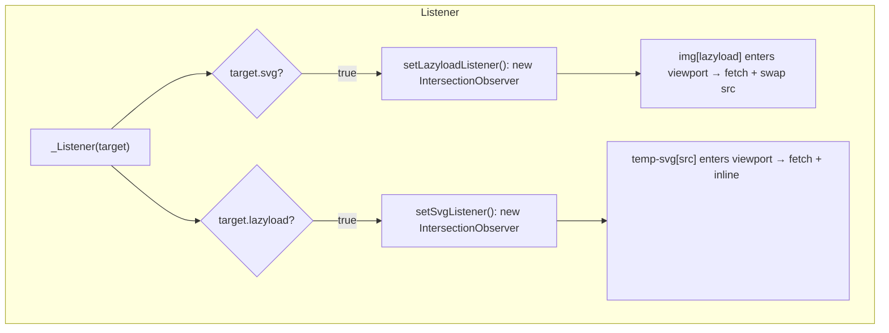

# Listener System

How `_Listener({ svg, lazyload })` sets up global `IntersectionObserver` instances for image lazyload and SVG inlining.

## Entry Point

`window._Listener` (`src/prototype/window.ts`) is the single entry point. Calling it with no argument enables both observers; calling it with an object gates each observer independently — `target.svg` controls whether `setLazyloadListener()` runs, and `target.lazyload` controls whether `setSvgListener()` runs. Both setup functions (`src/listener/LazyloadListener.ts`, `src/listener/SVGListener.ts`) check a module-level `lazyloadListener`/`svgListener` variable before creating an observer, but neither variable is ever assigned, so every call creates a new `IntersectionObserver` and re-observes the matching elements already in the page; `lazyloadObserver`/`svgObserver` always point at the most recent one.

The `RJS` constructor (`src/model/RJS.ts`) also calls `$window._Listener(body[listener] || {})` on every instantiation, so any page using `RJS` gets the listener(s) configured by that instance's `listener` option.



## Lazyload Observer

`setLazyloadListener()` creates one `IntersectionObserver` and immediately attaches it to every `img[lazyload]:not([lazyload=''])` already in `document.body`. New `img` elements built via `"img"._({ lazyload: url })` (see [String Extensions](/api-reference-string)) register with the same observer as soon as they're created, provided the observer already exists.

When a lazyload image intersects the viewport:

1. The observer unobserves it immediately (one-shot).
2. It reads the `lazyload` attribute as the real image URL.
3. `url.$$200(true)` fetches the URL and resolves an object-URL blob for the image.
4. On success, `img.src` is set to the resolved blob URL; on failure, `img.src` is set to `photo404` from `src/data.ts`, which holds a CSS `background-image: url("data:image/svg+xml,...")` declaration rather than a URL, so the image renders as broken.
5. The `lazyload` attribute is removed either way.

## SVG Inlining Observer

`setSvgListener()` creates a second `IntersectionObserver` and attaches it to every `temp-svg[src]:not([src=''])` element already present. When a matched element intersects:

1. `src.$$200()` fetches the SVG URL (without forcing image-blob conversion, since SVG responses are handled as text).
2. The fetched text is parsed into a detached `<div>`, and its first child (the `<svg>` element) is extracted.
3. The new `<svg>` inherits the placeholder's `id`, every class from its `classList`, and its `onclick` handler.
4. The `<svg>` is inserted immediately before the placeholder, which is then removed.
5. On any failure (fetch or parse), the placeholder's `innerHTML` is replaced with `☒`.

## Re-entrancy During `RJS` Rendering

`RJS.ts`'s `#SET_DOM` also observes newly-created child elements inline as it walks the DOM tree: any child carrying the `lazyload` class is registered with `lazyloadObserver`, and any `SPAN` carrying the `svg` class is registered with `svgObserver` — this is what lets elements produced by `:for` loops or `:path`-loaded fragments participate in lazyload/SVG inlining without a separate `_Listener()` call per fragment.

## Example

Both observers run with no argument: the image loads and the placeholder becomes an inline `<svg>`.

```demo
<style>.icon { width: 48px; height: 48px; }</style>

<temp-svg src="https://cdn.jsdelivr.net/npm/@fortawesome/fontawesome-free@6.5.2/svgs/solid/code.svg" class="icon"></temp-svg>
<script>
    "img".$.onload = () => console.log("lazyload image loaded");
    _Listener();
</script>
```
