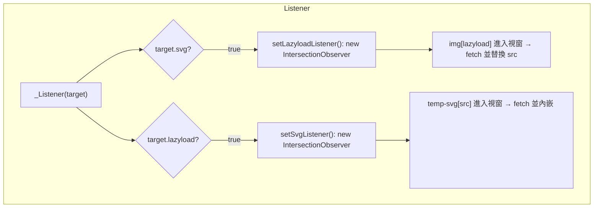

# Listener 系統

`_Listener({ svg, lazyload })` 如何建立全域的 `IntersectionObserver`，用於圖片延遲載入與 SVG 內嵌。

## 進入點

`window._Listener`（`src/prototype/window.ts`）是唯一的進入點。無參數呼叫會同時啟用兩個 observer；傳入物件時則各自獨立控制——`target.svg` 決定是否執行 `setLazyloadListener()`，`target.lazyload` 決定是否執行 `setSvgListener()`。兩個設定函式（`src/listener/LazyloadListener.ts`、`src/listener/SVGListener.ts`）建立 observer 前都會檢查模組層級的 `lazyloadListener`／`svgListener` 變數，但這兩個變數從未被賦值，因此每次呼叫都會建立新的 `IntersectionObserver` 並重新觀察頁面上既有的符合元素；`lazyloadObserver`／`svgObserver` 永遠指向最新建立的那一個。

`RJS` 建構子（`src/model/RJS.ts`）在每次實例化時也會呼叫 `$window._Listener(body[listener] || {})`，因此任何使用 `RJS` 的頁面都會依該實例的 `listener` 選項設定監聽器。



## Lazyload Observer

`setLazyloadListener()` 建立一個 `IntersectionObserver`，並立即附加至 `document.body` 中所有既有的 `img[lazyload]:not([lazyload=''])`。透過 `"img"._({ lazyload: url })`（見 [String 擴充](/zh/api-reference-string)）新建立的 `img` 元素，只要該 observer 已存在，會在建立當下就註冊至同一個 observer。

當延遲載入的圖片進入視窗範圍時：

1. observer 立即取消監聽該元素（一次性）。
2. 讀取 `lazyload` 屬性作為真正的圖片 URL。
3. `url.$$200(true)` fetch 該 URL，並解析出圖片的 object-URL blob。
4. 成功時將 `img.src` 設為解析出的 blob URL；失敗時 `img.src` 會被設為 `src/data.ts` 的 `photo404`，其內容是 CSS 宣告 `background-image: url("data:image/svg+xml,...")` 而非 URL，因此圖片會顯示為破圖。
5. 無論成功或失敗都會移除 `lazyload` 屬性。

## SVG 內嵌 Observer

`setSvgListener()` 建立第二個 `IntersectionObserver`，附加至所有既有的 `temp-svg[src]:not([src=''])` 元素。當符合的元素進入視窗範圍時：

1. `src.$$200()` fetch 該 SVG URL（不強制轉換為圖片 blob，因為 SVG 回應以文字方式處理）。
2. 將取得的文字解析至一個未掛載的 `<div>`，並取出其第一個子節點（`<svg>` 元素）。
3. 新的 `<svg>` 會繼承佔位元素的 `id`、`classList` 中的每個 class，以及 `onclick` handler。
4. `<svg>` 會被插入至佔位元素之前，佔位元素隨後被移除。
5. 任一步驟失敗（fetch 或解析）時，佔位元素的 `innerHTML` 會被替換為 `☒`。

## RJS 渲染過程中的重入註冊

`RJS.ts` 的 `#SET_DOM` 在走訪 DOM 樹時，也會就地觀察新建立的子元素：任何帶有 `lazyload` class 的子節點會註冊至 `lazyloadObserver`，任何帶有 `svg` class 且 `tagName` 為 `SPAN` 的子節點會註冊至 `svgObserver`——這使得 `:for` 迴圈或 `:path` 載入片段所產生的元素，無需為每個片段額外呼叫 `_Listener()` 即可參與 lazyload／SVG 內嵌。

## 範例

不帶參數時兩個 observer 都啟用：圖片載入完成，佔位元素換成內嵌 `<svg>`。

```demo
<style>.icon { width: 48px; height: 48px; }</style>

<temp-svg src="https://cdn.jsdelivr.net/npm/@fortawesome/fontawesome-free@6.5.2/svgs/solid/code.svg" class="icon"></temp-svg>
<script>
    "img".$.onload = () => console.log("lazyload image loaded");
    _Listener();
</script>
```
